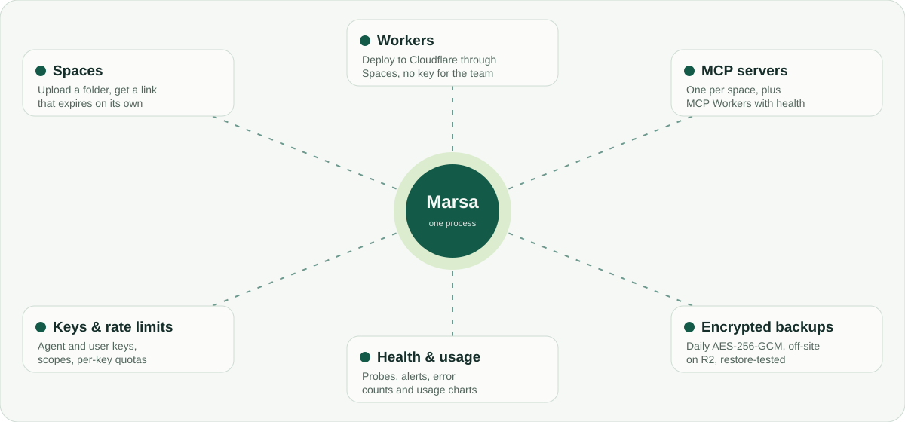
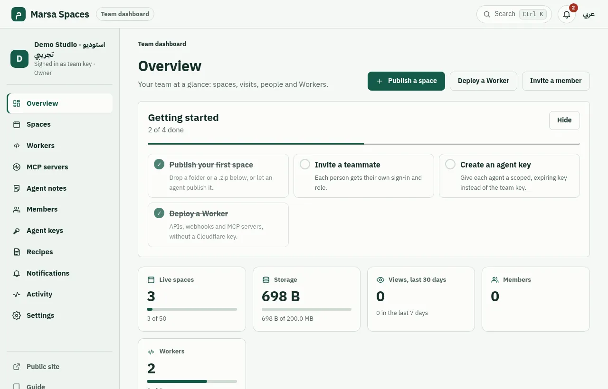
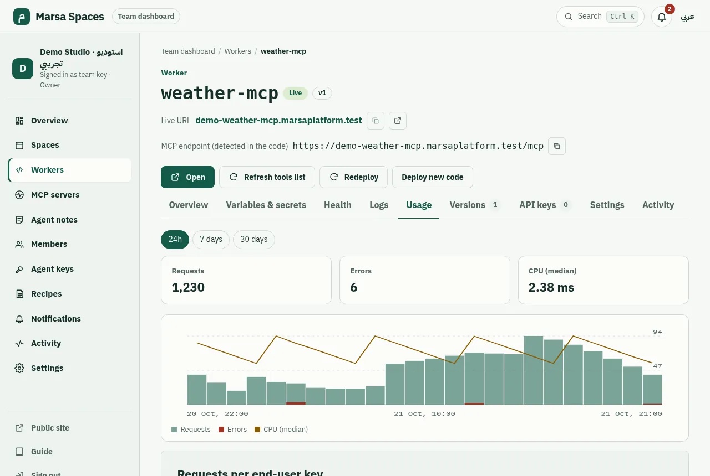
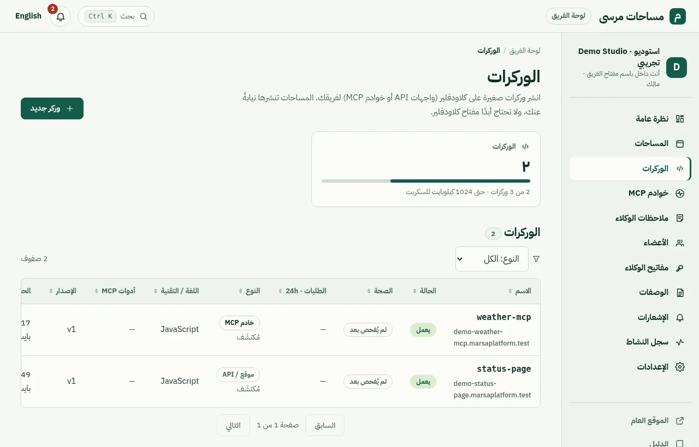
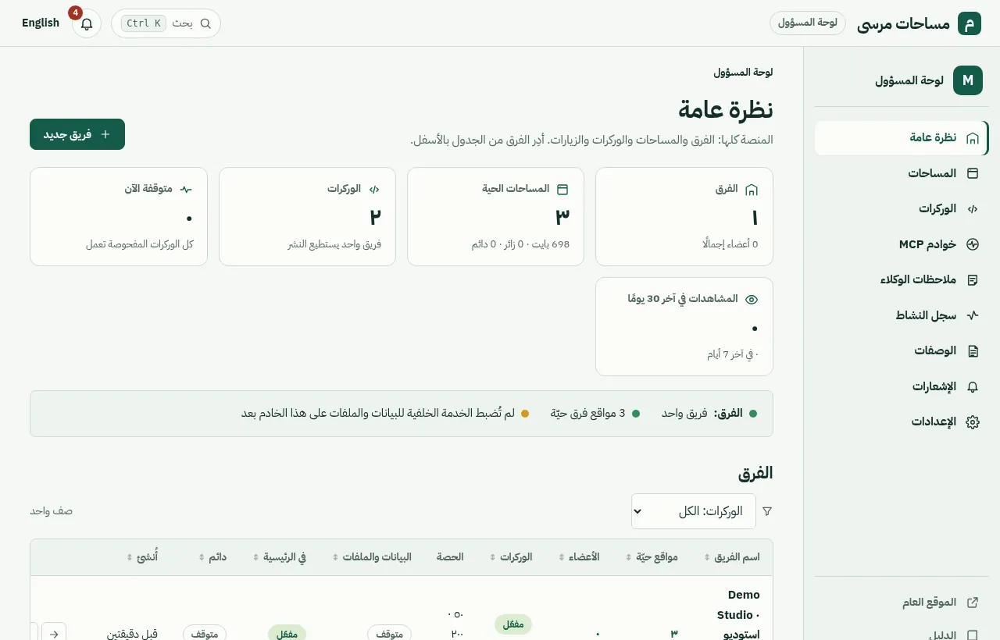

<p align="center">
  <picture>
    <source media="(prefers-color-scheme: dark)" srcset="docs/assets/hero-dark.svg">
    
  </picture>
</p>

<p align="center">
  <a href="CHANGELOG.md"></a>
  <a href="https://github.com/marsaplatform/marsa/actions/workflows/ci.yml"></a>
  <a href="LICENSE"></a>
  
  
  
  
</p>

<p align="center">
  <a href="https://spaces.marsaplatform.com"><b>Hosted instance</b></a> ·
  <a href="#quick-start">Quick start</a> ·
  <a href="docs/README.md">Docs</a> ·
  <a href="#docs-changelog-and-security">Changelog &amp; security</a> ·
  <a href="#بالعربي">العربية ↓</a>
</p>

**Marsa is the harbor where your AI agent's work lands.**
Turn any static page, HTML report or prototype into a shareable link in seconds, with no account.

*Marsa* (مَرسى) is Arabic for "harbor". Upload a folder, some files or a `.zip` from the browser,
`curl`, an AI agent or CI. You get back a public link that **expires on its own** and a private
**edit token** to update, extend or delete it. It's one Node.js process and one data folder, with no
database, and it's MIT licensed.


## At a glance

- **Spaces**: publish a page, report or prototype with one call and get a link that expires on its own.
- **Workers**: teams deploy Cloudflare Workers (APIs, webhooks, MCP servers) through Spaces. The admin's
  Cloudflare token stays hidden on the server.
- **MCP**: every space has its own MCP server, and MCP Workers get health checks and a tools list.
- **Keys and limits**: scoped agent and end-user keys with expiry, per-key rate limits and quotas.
- **Health and usage**: uptime probes, alerts, error counts, logs and usage charts per Worker.
- **Safety**: daily encrypted off-site backups with restore tests, team trash and export, and an audit log.

<p align="center">
  <picture>
    <source media="(prefers-color-scheme: dark)" srcset="docs/assets/features-dark.svg">
    
  </picture>
</p>

### Screenshots

These come from a local demo instance with made-up data.

<table>
  <tr>
    <td width="50%"><br><sub>Team dashboard with the getting-started checklist</sub></td>
    <td width="50%"><br><sub>Worker usage: requests, errors and CPU by hour</sub></td>
  </tr>
  <tr>
    <td width="50%"><br><sub>Workers list in Arabic (RTL)</sub></td>
    <td width="50%"><br><sub>Admin overview in Arabic</sub></td>
  </tr>
</table>

## Why Marsa

- **Agents produce HTML, people need links.** Reports, dashboards and prototypes are easier to review
  in a browser than as a code block. One HTTP call turns them into a URL.
- **No account wall.** Whoever gets the link can open it, and whoever uploads doesn't have to sign up.
  The edit token is the only credential.
- **Nothing lingers.** Every link has an expiry (1 hour to 7 days by default). Expired sites are deleted
  from disk by a background sweeper.
- **Small enough to own.** Self-host it in one command, read the whole codebase in an afternoon, and
  build on it.

## Do I need to install anything?

| You want to… | You need |
| --- | --- |
| Use a Marsa instance someone runs | **Nothing.** Upload in the browser or call the API. |
| Host your own Marsa | **Only Marsa**, one Docker command (below). No database, no other services. All publishing features work without anything else. |
| Give pages and agents data/file storage | The **optional** backend: a [Cloudflare](https://www.cloudflare.com) account (free plan works) with a Workers KV namespace and an R2 bucket, connected with env vars. Nothing to install. Off by default. |

Without the `CLOUDFLARE_*` / `R2_*` variables, Marsa starts normally and the backend routes answer
`503 BACKEND_NOT_CONFIGURED`. Even with Cloudflare configured, only sites of a **team** the admin gave
backend access can use it (see [Teams](docs/teams.md)).

## Features

- **Upload from the browser** by dragging files, a folder or a ZIP onto the page at `/` or `/new`.
- **Deploy API** at `POST /api/sites`, accepting a ZIP, multipart files or JSON `files[]`. The response
  includes `url`, `expiresAt`, `id` and `editToken`.
- **Expiring links** with a configurable TTL (default 24h, max 7d). A link never outlives created + max.
- **Token management**: replace the files (`PUT`), change the expiry (`PATCH`) or delete (`DELETE`).
  Only a SHA-256 of the token is stored.
- **Made for agents**: `/llms.txt` (instructions with this instance's URL and limits), `/openapi.json`
  (OpenAPI 3.1), a ready-made prompt and deploy scripts.
- **Abuse limits**: per-file, per-site and file-count caps, per-IP rate limits, blocked server-side and
  executable types, zip-slip and zip-bomb guards, and dotfiles are stripped.
- **Sandboxed serving**: uploaded pages get a `sandbox` CSP (opaque origin), `nosniff`, `noindex`
  and `frame-ancestors 'none'`.
- **Bilingual UI and docs**: English and Arabic (RTL), server-rendered. The guide is at `/docs` and `/ar/docs`.
- **Optional admin API** behind `ADMIN_TOKEN`: list and delete any site, and run the sweeper.
- **Team sign-in and dashboard** at `/login` and `/team`: a team member signs in with the team key
  (signed `HttpOnly` session cookie, CSRF-protected forms, rate-limited sign-in) to publish by drag and
  drop, replace files, extend, hide from the home page or delete the team's sites, and browse each
  site's KV values and files. Agents keep using `X-Team-Key`.
- **Admin console** at `/admin/login`: create teams with a team key, choose per team whether its sites
  get the data/files backend and whether they appear in the **public directory** on the homepage
  (`GET /api/directory`), and see or delete every live site, filtered by team or guests.
  Teams can invite **members** (owner, editor, viewer) with single-use links; the team key keeps
  working for agents and as an owner sign-in. See [docs/teams.md](docs/teams.md).
- **Marsa platform look**: the Zad typeface (self-hosted, SIL OFL), the marsaplatform.com palette,
  Arabic first and RTL-correct, light and dark, responsive, keyboard and screen-reader friendly.
- **Optional data/files backend** (Cloudflare Workers KV + R2): per-site KV and files, a browser SDK at `/sdk.js`, and
  automatic cleanup when a site goes away.

## Who it's for

- **Agent builders**: give your agent one call that returns a link instead of pasting HTML into chat.
- **Developers showing clients**: send a clickable prototype without hosting setup or client accounts.
- **CI previews**: post a preview link of every pull request's static build, which expires by itself.
- **Teachers and students**: students hand in HTML/CSS assignments as links, and teachers review them in a browser.
- **Temporary event pages**: a schedule and RSVP page for a meetup that's gone next week.

Fictional sample sites for each case are in [`examples/`](examples).

## Quick start

With Docker (from a clone of this repo):

```bash
docker compose up -d --build          # http://localhost:8080, data in the "marsa-data" volume
```

or without compose: `docker build -t marsa . && docker run -d -p 8080:8080 -v marsa-data:/data marsa`

With Node.js 20+:

```bash
npm install
npm run dev                           # http://localhost:8080, reloads on change
# production: npm run build && npm start
```

## Usage

### Browser

Open the home page, drop files (or a folder or a `.zip`), pick an expiry and copy the link. The
browser remembers your uploads and their tokens under **Your drops in this browser**, so you can
delete them later. See [Getting started](docs/getting-started.md).

### API

```bash
(cd my-site && zip -qr ../site.zip .)
curl -s -X POST "http://localhost:8080/api/sites?ttlHours=24" \
  -H "Content-Type: application/zip" --data-binary @site.zip
# {"id":"k3v9x2mq7a","url":"http://localhost:8080/s/k3v9x2mq7a/","expiresAt":"…","editToken":"marsa_…",…}

curl -s -X POST http://localhost:8080/api/sites -H "Content-Type: application/json" \
  -d '{"ttlHours": 6, "files": [{"path": "index.html", "content": "<h1>Hello</h1>"}]}'
```

The full reference with error codes is in [docs/api.md](docs/api.md), and the machine-readable spec is at `/openapi.json`.

### AI agents

Point the agent at `https://<your-instance>/llms.txt`, or paste the prompt from
[`examples/agent/prompt.md`](examples/agent/prompt.md). In code:

```js
const res = await fetch("http://localhost:8080/api/sites", {
  method: "POST",
  headers: { "content-type": "application/json" },
  body: JSON.stringify({ ttlHours: 24, files: [{ path: "index.html", content: html }] }),
});
const { url, expiresAt, id, editToken } = await res.json();
```

Shell, Node.js and Python deploy scripts are in [`examples/agent/`](examples/agent). More details
are in [docs/agents.md](docs/agents.md).

### MCP per space

Each site also has its own **MCP server** at `/mcp/s/<siteId>` (Streamable HTTP, stateless), e.g.
`https://spaces.marsaplatform.com/mcp/s/<siteId>` on the hosted instance. Create a read-only or
read-write token (`marsa_mcp_…`, shown once) on the site page of the team dashboard, then:

**Cursor** (`.cursor/mcp.json`):

```json
{
  "mcpServers": {
    "marsa-<siteId>": {
      "url": "https://spaces.marsaplatform.com/mcp/s/<siteId>",
      "headers": { "Authorization": "Bearer marsa_mcp_…" }
    }
  }
}
```

**Claude Code**:

```bash
claude mcp add --transport http marsa-<siteId> \
  https://spaces.marsaplatform.com/mcp/s/<siteId> \
  --header "Authorization: Bearer marsa_mcp_…"
```

**Claude Desktop** (`claude_desktop_config.json`, via [`mcp-remote`](https://www.npmjs.com/package/mcp-remote)
because the token goes in a header):

```json
{
  "mcpServers": {
    "marsa-<siteId>": {
      "command": "npx",
      "args": ["-y", "mcp-remote", "https://spaces.marsaplatform.com/mcp/s/<siteId>",
               "--header", "Authorization:${AUTH_HEADER}"],
      "env": { "AUTH_HEADER": "Bearer marsa_mcp_…" }
    }
  }
}
```

Tools: `get_site_info`, `list_files`, `read_file` (read-only) and `replace_site_files` (read-write);
with the team backend also `kv_list`, `kv_get`, `list_uploads` (read-only) and `kv_put`, `kv_delete`,
`upload_file`, `delete_file` (read-write). A token only sees the tools its scope allows. Without a
valid token the endpoint answers `401`. Example prompt: *"List the files in this space and summarise
index.html"*. Full reference: [docs/mcp.md](docs/mcp.md).

### Managing with the token

```bash
curl -s -X PUT    "$BASE/api/sites/$ID" -H "Authorization: Bearer $TOKEN" \
     -H "Content-Type: application/zip" --data-binary @site.zip                         # replace files
curl -s -X PATCH  "$BASE/api/sites/$ID" -H "Authorization: Bearer $TOKEN" \
     -H "Content-Type: application/json" -d '{"ttlHours": 48}'                           # change expiry
curl -s -X DELETE "$BASE/api/sites/$ID" -H "Authorization: Bearer $TOKEN"                # delete now
```

A wrong token and a missing site both return `404`. See [docs/managing.md](docs/managing.md).

## Optional data & files backend (Cloudflare)

For pages and agents that need to store a little state (KV) or files, Marsa can proxy per-site
storage to Cloudflare (values in Workers KV, files in R2, over Cloudflare's HTTP APIs; no Worker needed).
Here's what it adds:

- `GET/PUT/DELETE /api/sites/:id/kv/:key`, plus `GET /api/sites/:id/kv` to list keys
- `POST/GET /api/sites/:id/files` and `GET/DELETE /api/sites/:id/files/:fileId`
- `/sdk.js` for pages: `marsa.kv.get(key)`, `marsa.files.list()`, and writes after `marsa.auth(token)`
- Writes always need the edit token. Reads are public while the site is live (`BACKEND_PUBLIC_READ=true`).
- Data is purged from Cloudflare when the site expires or is deleted. The API token and R2 keys never reach browsers.
- **Only sites uploaded with the key of a team that has backend access** may use it. Others get
  `403 BACKEND_NOT_ALLOWED` (set `BACKEND_GUEST_ACCESS=true` to allow every site). Allowed teams on an
  instance without the backend configured get `503 BACKEND_NOT_CONFIGURED`.

Setup (placeholders):

```bash
# token permissions: Workers KV Storage: Edit + Workers R2 Storage: Edit
CLOUDFLARE_ACCOUNT_ID=… CLOUDFLARE_API_TOKEN=… \
  node scripts/cloudflare-setup.mjs --write-env .env   # creates/reuses the KV namespace + R2 bucket
```

```bash
CLOUDFLARE_ACCOUNT_ID=0123456789abcdef0123456789abcdef
CLOUDFLARE_API_TOKEN=your-api-token
CLOUDFLARE_KV_NAMESPACE_ID=your-kv-namespace-id
R2_ACCESS_KEY_ID=your-r2-access-key-id          # = the token id (derived by the setup script)
R2_SECRET_ACCESS_KEY=your-r2-secret-access-key  # = sha256(token value) (derived by the setup script)
```

You must set all five required values or none; a partial config stops startup with a message. The full
guide is in [docs/backend.md](docs/backend.md).

## Configuration

All settings are environment variables, and all are optional. See [`.env.example`](.env.example).

| Variable | Default | Meaning |
| --- | --- | --- |
| `PORT` / `HOST` | `8080` / `0.0.0.0` | Listen address |
| `PUBLIC_URL` | `http://localhost:$PORT` | Base for share links, docs and `/llms.txt` |
| `DATA_DIR` | `./data` (`/data` in Docker) | Where sites are stored |
| `DEFAULT_TTL_HOURS` / `MIN_TTL_HOURS` / `MAX_TTL_HOURS` | `24` / `1` / `168` | Link lifetime |
| `SWEEP_INTERVAL_SECONDS` | `60` | How often expired sites are deleted |
| `MAX_FILE_MB` / `MAX_SITE_MB` / `MAX_FILES` | `10` / `25` / `500` | Size and count caps |
| `UPLOADS_PER_HOUR` | `20` | Creates, updates and backend file uploads per IP per hour |
| `API_REQUESTS_PER_MINUTE` | `120` | Any `/api` request per IP per minute |
| `TRUST_PROXY` | `false` | Use `X-Real-IP` / the last `X-Forwarded-For` hop as the client IP |
| `ADMIN_TOKEN` | empty (off) | Enables `/api/admin/*` and the admin console (min. 24 chars) |
| `SESSION_SECRET` | random per start | HMAC key for sign-in cookies and CSRF tokens (min. 32 chars). Set it, or everyone is signed out on restart |
| `SESSION_TTL_HOURS` / `ADMIN_SESSION_TTL_HOURS` | `168` / `12` | Team and admin session lifetime |
| `LOGIN_ATTEMPTS_PER_15_MIN` | `10` | Sign-in attempts per IP per 15 minutes |
| `CLOUDFLARE_ACCOUNT_ID` / `CLOUDFLARE_API_TOKEN` / `CLOUDFLARE_KV_NAMESPACE_ID` / `R2_ACCESS_KEY_ID` / `R2_SECRET_ACCESS_KEY` | empty (off) | Optional backend; set all five or none |
| `R2_BUCKET` | `marsa-files` | R2 bucket for backend files |
| `R2_ENDPOINT` | `https://<account>.r2.cloudflarestorage.com` | Only for EU/FedRAMP jurisdiction buckets |
| `BACKEND_GUEST_ACCESS` | `false` | `true` lets every site (guests too) use the backend; default is teams with backend access only |
| `BACKEND_PUBLIC_READ` | `true` | Public reads of a live site's KV and files |
| `BACKEND_MAX_VALUE_KB` / `BACKEND_MAX_KEYS` / `BACKEND_MAX_FILES` | `64` / `1000` / `100` | Backend caps per site |

## Security and limits

- **Everything uploaded is public to anyone with the link.** Site ids are random but aren't passwords.
- Uploaded pages are served under `/s/<id>/` with `Content-Security-Policy: sandbox …`. They run with
  an opaque origin, so they can't read the app's storage or the uploader's tokens, and can't call the
  API as the visitor. App pages use a strict CSP with no inline code.
- Uploads are validated before anything is written: declared ZIP sizes are checked before inflating,
  along with path traversal, blocked types (`.php`, `.py`, `.sh`, `.exe`, …), dotfiles and the caps above.
- Edit tokens are 256-bit random values. Only their SHA-256 is stored, and comparisons are constant-time.
- Client IPs are used only as in-memory rate-limit keys and are never stored or logged.
- Rate limits are per process. Run a single instance, or add limits at your proxy.
- See [SECURITY.md](SECURITY.md) for reporting vulnerabilities.

## Architecture

```
          browser / curl / AI agent / CI
                       │ HTTP
┌──────────────────────▼───────────────────────────────────┐
│ Hono app (src/app.ts)                                    │
│  pages  /, /ar, /new, /docs     ui.ts, i18n.ts, docs.ts  │
│  agent  /llms.txt, /openapi.json, /sdk.js                │
│  api    /api/sites…  rate-limit.ts, tokens.ts            │
│           └ ingest.ts → paths.ts, mime.ts, caps          │
│  serve  /s/<id>/*    sandbox CSP (security.ts)           │
│  opt.   /api/sites/:id/kv|files  backend/routes.ts       │
└──────────┬──────────────────────────────┬────────────────┘
           │ store.ts (staged + rename)   │ backend/cloudflare.ts (fetch + aws4fetch)
   DATA_DIR/sites/<id>/meta.json          ▼
   DATA_DIR/sites/<id>/files/…      Cloudflare: Workers KV namespace, R2 bucket
           ▲
  index.ts + sweep.ts: delete expired sites (and their backend data) every minute
```

- Each site is a folder with a `meta.json` (expiry, file list, token hash). Writes are staged in
  `DATA_DIR/tmp` and swapped in with `rename()`.
- UI strings live in `src/i18n.ts`, and pages are rendered per language on the server.
- The backend is an interface (`src/backend/types.ts`) with a Cloudflare implementation. Tests use an
  in-memory one and a mocked Cloudflare HTTP API (`test/fake-cloudflare.ts`).

```
src/       app index config brand ui assets i18n docs llms openapi sdk sweep
           ingest paths mime store tokens rate-limit security client-ip errors
src/backend/  types cloudflare routes
docs/      guides served at /docs        examples/  sample sites, CI workflow, agent scripts
test/      vitest suites                 scripts/   smoke.mjs, cloudflare-setup.mjs, rename.mjs
```

## Docs, changelog and security

| | |
| --- | --- |
| **Guides** | [Getting started](docs/getting-started.md) · [API](docs/api.md) · [Agents](docs/agents.md) · [MCP](docs/mcp.md) · [Teams](docs/teams.md) · [Workers](docs/workers.md) · [Agent keys](docs/agent-keys.md) · [Data backend](docs/backend.md) |
| **Deploy** | [Self-hosting](docs/self-hosting.md) (Docker, env vars, reverse proxy, backups) |
| **Recipes for agents** | [docs/recipes](docs/recipes) (MCP server on a Worker, protecting MCP with keys, security rules) |
| **Arabic docs** | [docs/ar](docs/ar) · [الدليل](docs/ar/guide.md) |
| **Changelog and roadmap** | [CHANGELOG.md](CHANGELOG.md) · [open issues](https://github.com/marsaplatform/marsa/issues) |
| **Security** | [SECURITY.md](SECURITY.md) (report a vulnerability privately) |
| **Privacy** | `/privacy` on every instance ([hosted](https://spaces.marsaplatform.com/privacy)) |

## Contributing

```bash
npm install
npm run lint && npm run typecheck && npm test
npm run build && (npm start &) && npm run smoke
```

Keep it small: one process, no required services. UI text must be in English and Arabic. See
[CONTRIBUTING.md](CONTRIBUTING.md), the [CHANGELOG](CHANGELOG.md) and the issue/PR templates.

## License and why open source

[MIT](LICENSE). Marsa is derived from [canvas-drop](https://github.com/markpasternak/canvas-drop) (MIT);
see [NOTICE](NOTICE).

Marsa is open source because a place to drop work should be one you control:

- **Self-host** it next to your agents, on your own domain, with your own limits.
- **Own your data.** Uploads live in a folder on your server (plus your own Cloudflare account if you
  enable the backend), and they're deleted when they expire.
- **Build on it.** It's small, typed and tested. Fork it, embed it in your agent platform, or add
  storage drivers.

---

<div dir="rtl">

## Sibling Marsa projects · مشاريع مرسى الشقيقة

| Project | What | Link |
| --- | --- | --- |
| **Atlas MCP · أطلس** | Source-cited migration & asylum services, organizations and legal references for Egypt (21 tools, no key) | <https://atlas.marsaplatform.com/mcp> · [GitHub](https://github.com/marsaplatform/atlas-mcp) |
| **ERX · مرصد مصر البحثي** | Egypt Research Commons: research archive + MCP for Egyptian public affairs (hosted MCP needs a free API key) | <https://egypt-research.marsaplatform.com> · [GitHub](https://github.com/marsaplatform/erx-mcp) |
| **Malja MCP · ملجأ** | Humanitarian & refugee data (UNHCR, World Bank, HDX, ReliefWeb) with sources; self-hosted, hosted endpoint coming soon | [Project page](https://spaces.marsaplatform.com/s/k3sb9ww3dj/) |

## بالعربي

**Marsa هو المرسى اللي شغل الـ AI agent بتاعك بيرسى فيه.**
حوّل أي صفحة ثابتة أو تقرير HTML أو نموذج أولي لرابط تشاركه في ثواني، من غير حساب.

### شكلها إيه

<p align="center">
  
  
</p>

- **المساحات**: انشر صفحة أو تقرير بطلب واحد، وخد رابط بينتهي لوحده.
- **الوركرز**: الفرق بتنشر Cloudflare Workers (واجهات API وwebhooks وخوادم MCP) من خلال Spaces، ومفتاح Cloudflare بيفضل مخفي على السيرفر.
- **MCP**: كل مساحة ليها خادم MCP، وخوادم MCP على الوركرز ليها فحص صحة وقائمة أدوات.
- **المفاتيح والحدود**: مفاتيح للـ agents وللمستخدمين بصلاحيات ومدة، وحدود طلبات لكل مفتاح.
- **الصحة والاستخدام**: فحص تشغيل وتنبيهات وأعداد أخطاء وسجلات ورسوم استخدام لكل وركر.
- **الأمان**: نسخ احتياطية مشفّرة يومية خارج السيرفر مع اختبار استعادة، وسلة محذوفات للفرق وتصدير وسجل نشاط.

### ليه Marsa؟
- الـ agents بتطلّع HTML، والناس محتاجة روابط. طلب HTTP واحد بيحوّل الشغل لرابط.
- من غير حسابات: اللي معاه الرابط يفتحه، واللي بيرفع مش محتاج يسجّل. مفتاح التعديل هو كل اللي محتاجه.
- مفيش حاجة بتفضل: كل رابط ليه مدة، وبعدها الملفات بتتمسح.
- صغير وتقدر تمتلكه: بتشغّله بأمر واحد، وكوده يتقري في يوم.

### محتاج أنزّل حاجة؟
- **لو بتستخدم نسخة شغالة**: ولا حاجة. ارفع من المتصفح أو استخدم الـ API.
- **لو هتشغّل نسختك**: Marsa بس، بأمر Docker واحد. من غير قاعدة بيانات ولا خدمات تانية، وكل مميزات النشر شغالة.
- **الـ backend الاختياري للبيانات والملفات**: محتاج حساب Cloudflare (الخطة المجانية كفاية) فيه Workers KV وR2، من غير ما تنزّل حاجة، وبيتربط بمتغيرات البيئة. ومقفول افتراضيًا، والـ routes بتاعته بترد `503 BACKEND_NOT_CONFIGURED`.

### المميزات
رفع بالسحب والإفلات، وAPI للنشر (ZIP أو ملفات أو JSON)، وروابط بتنتهي لوحدها، ومفتاح للتعديل والمسح، و`/llms.txt` و`/openapi.json` للـ agents، وحدود ضد الإساءة، وعرض آمن جوه sandbox، وواجهة ودليل بالعربي والإنجليزي، ودخول للفرق على `/login` بمفتاح الفريق ولوحة خاصة على `/team` (نشر بالسحب والإفلات، واستبدال الملفات، والتمديد، والإخفاء من الرئيسية، والحذف، وتصفّح قيم KV والملفات لكل موقع)، ولوحة مسؤول على `/admin/login` فيها الفرق بمفاتيحها (تحدد لكل فريق إذا كان له باك إند وإذا كان يظهر في دليل الصفحات العام على الرئيسية) وكل المواقع الحيّة مع التصفية والحذف، والجلسات بملف cookie موقّع `HttpOnly` مع حماية CSRF وحد لمحاولات الدخول، وbackend اختياري (KV وملفات) عن طريق Cloudflare Workers KV وR2.

### لمين؟
اللي بيبنوا agents، والمطورين اللي بيعرضوا شغل على عملاء، ومعاينات الـ CI، والمدرّسين والطلبة، وصفحات الإيفنتات المؤقتة. وفي `examples/` أمثلة وهمية لكل حالة.

### التشغيل السريع

</div>

```bash
docker compose up -d --build      # http://localhost:8080
# أو بـ Node.js 20+
npm install && npm run dev
```

<div dir="rtl">

### الاستخدام
- **المتصفح**: افتح الصفحة الرئيسية (`/ar`)، اسحب الملفات، اختار المدة، وانسخ الرابط.
- **الـ API**: `POST /api/sites` بملف zip أو JSON، والرد فيه `url` و`editToken`.
- **الـ agents**: وجّه الـ agent لـ `/llms.txt` أو ادّيله البرومبت اللي في `examples/agent/prompt.md`.
- **الإدارة**: `PUT` و`PATCH` و`DELETE` على `/api/sites/<id>` بالهيدر `Authorization: Bearer <editToken>`.
- **MCP لكل مساحة**: كل موقع ليه خادم MCP على `/mcp/s/<siteId>` (مثلًا `https://spaces.marsaplatform.com/mcp/s/<siteId>`). اعمل توكن قراءة بس أو قراءة وكتابة من صفحة الموقع في لوحة الفريق (بيظهر مرة واحدة)، وابعته في الهيدر `Authorization: Bearer marsa_mcp_…`. إعدادات Cursor وClaude Code وClaude Desktop في القسم الإنجليزي فوق وفي [`docs/mcp.md`](docs/mcp.md).

النسخة المستضافة: <https://spaces.marsaplatform.com> · كل مشاريع مرسى: <https://marsaplatform.com/products>

الدليل الكامل بالعربي في [`docs/ar/guide.md`](docs/ar/guide.md) وعلى `/ar/docs`.

### الإعدادات والأمان
كل الإعدادات متغيرات بيئة اختيارية (الجدول فوق و`.env.example`). أي حاجة بتترفع بتبقى متاحة لأي حد معاه الرابط، والصفحات بتشتغل جوه sandbox، والمفاتيح بتتخزن كـ hash بس، والـ IP مش بيتسجّل.

### إزاي تساهم
اعمل fork، وبعدين `npm install`، واعمل التعديل ومعاه اختبار، وخلي نصوص الواجهة بالعربي والإنجليزي، وشغّل `npm run lint && npm run typecheck && npm test`، وافتح Pull Request.

### روابط
[الدليل](docs/ar/guide.md) · [الوركرز](docs/ar/workers.md) · [التشغيل على سيرفرك](docs/ar/self-hosting.md) · [سجل التغييرات](CHANGELOG.md) · [الأمان](SECURITY.md) · [الخصوصية](https://spaces.marsaplatform.com/ar/privacy)

### الترخيص وليه مفتوح المصدر
MIT، ومبني على canvas-drop (MIT). مفتوح المصدر علشان تشغّله عندك، وبياناتك تفضل معاك، وتبني عليه.

</div>
